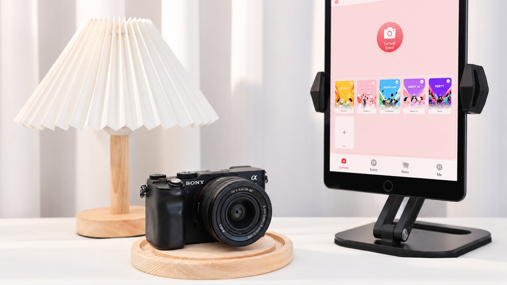
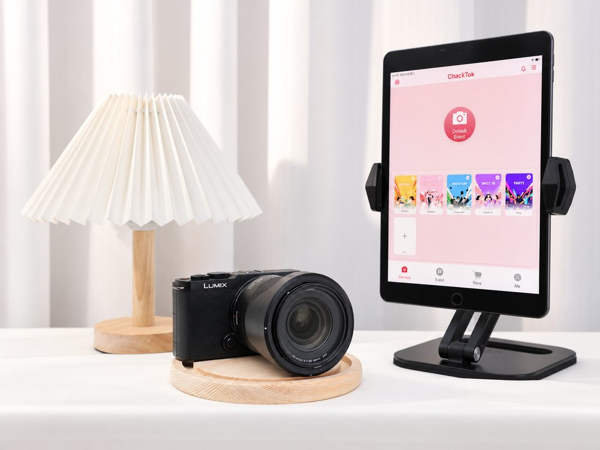
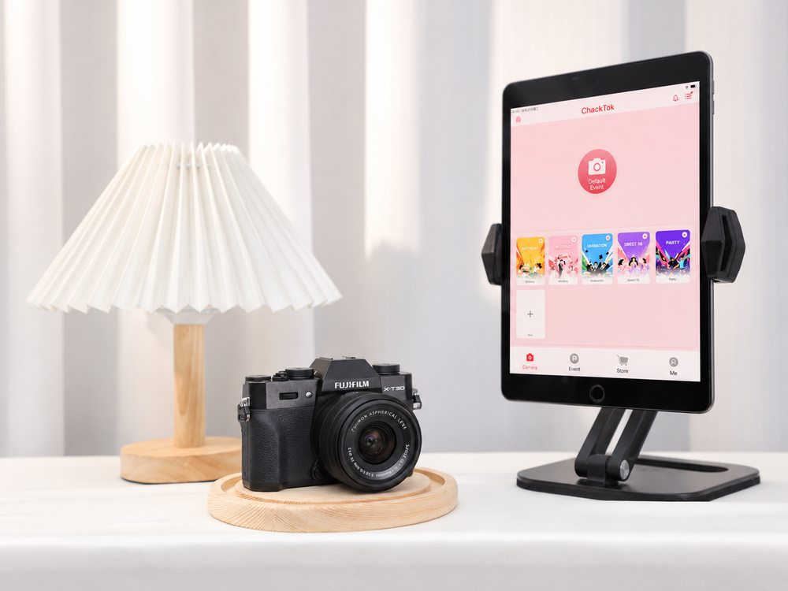
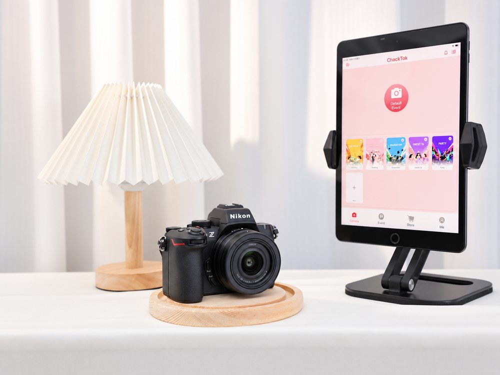

# ChackTok Launches Mirrorless Camera Photo Booth Compatibility Program with Canon EF Lens Adapter Support for 360 Photo Booths

## Sony a6100, Sony a7C, Nikon Z50 II, Fujifilm X-T30 II and Panasonic LUMIX S9 are now being adapted to the ChackTok platform, so event professionals and rental companies can run 360 and robotic-arm booths with cameras and Canon EF lenses they already own

*A Sony a7C next to an iPad running the ChackTok photo booth app. The Sony a7C is one of five mirrorless cameras in the ChackTok compatibility program. Photo: ChackTok.*

**London, United Kingdom — October 2026** — ChackTok, the professional event imaging software platform for photo booths, robotic camera arms and 3D scanning systems, is extending its booth platform to the mirrorless cameras that professionals and rental companies already own. The ChackTok mirrorless camera compatibility program starts with five top-selling bodies across Sony, Nikon, Fujifilm and Panasonic: the Sony a6100, Sony a7C, Nikon Z50 II, Fujifilm X-T30 II and Panasonic LUMIX S9. Each is paired with a named Canon EF lens adapter, so operators can reuse their EF glass. As of March 2026, ChackTok had more than 390,000 registered users, more than 65,000 photo booth devices connected and controlled, and more than 780,000 commercial events supported.

### Mirrorless cameras and Canon EF lens adapters in the program

Every camera in the program comes from the top 100 models by market share. These are the bodies event teams already carry, rent or can source quickly. Each pairing uses a smart adapter whose maker specifies autofocus, electronic aperture control and EXIF data transfer for Canon EF and EF-S lenses.

| Camera | Sensor format (manufacturer spec) | Mount | Canon EF lens adapter | Canon EF / EF-S lenses |
|---|---|---|---|---|
| [Sony a6100](https://www.sony.com/electronics/support/e-mount-body-ilce-6000-series/ilce-6100/specifications) | APS-C, 24.2 MP (23.5 × 15.6 mm) | Sony E | [Metabones EF-E Smart Adapter Mark V](https://www.metabones.com/products/details/MB-EF-E-BT5) (MB_EF-E-BT5) | EF-S 18-55mm f/3.5-5.6 IS II; EF 28-80mm f/3.5-5.6 |
| [Sony a7C](https://www.sony.com/electronics/support/e-mount-body-ilce-7-series/ilce-7c/specifications) | 35mm full frame, 24.2 MP (35.6 × 23.8 mm) | Sony E | [Metabones EF-E Smart Adapter Mark V](https://www.metabones.com/products/details/MB-EF-E-BT5) (MB_EF-E-BT5) | EF-S 18-55mm f/3.5-5.6 IS II; EF 28-80mm f/3.5-5.6 |
| [Nikon Z50 II](https://imaging.nikon.com/imaging/lineup/mirrorless/z50_2/) | DX / APS-C, 20.9 MP (23.5 × 15.7 mm) | Nikon Z | [Fringer EF-NZ II](https://www.fringeradapter.com/canon-ef-to-nikon-z) (FR-NZ2) | EF-S 18-55mm f/3.5-5.6 IS II; EF 28-80mm f/3.5-5.6 |
| [Fujifilm X-T30 II](https://www.fujifilm-x.com/global/products/cameras/x-t30-ii/) | APS-C X-Trans CMOS 4, 26.1 MP (23.5 × 15.6 mm) | Fujifilm X | [Fringer EF-FX Pro III](https://www.fringeradapter.com/canon-ef-to-fujifilm-x) (FR-FX3) | EF-S 18-55mm f/3.5-5.6 IS II |
| [Panasonic LUMIX S9](https://www.panasonic.com/uk/consumer/cameras-camcorders/lumix-mirrorless-cameras/lumix-s-full-frame-cameras/dc-s9.specs.html) | 35mm full frame, 24.2 MP (35.6 × 23.8 mm) | L-Mount | [Viltrox EF-L Pro](https://viltrox.com/products/viltrox-ef-l-mount-adapter-with-positive-lock-for-ef-ef-s-lens-to-l-mount-cameras) | EF 28-80mm f/3.5-5.6 |

### Which configuration fits which event

| Configuration | Framing with the paired lens | Best-fit event task | Why it fits |
|---|---|---|---|
| Sony a7C + Metabones Mark V + EF 28-80mm | True 28mm wide to 80mm on full frame | Full-body 360 spins and large group shots | A full-frame sensor keeps the full 28mm field of view |
| Panasonic LUMIX S9 + Viltrox EF-L Pro + EF 28-80mm | True 28mm wide to 80mm on full frame | Compact full-frame setups for brand activations | Full-frame body; the Viltrox EF-L Pro locks the lens to the mount |
| Nikon Z50 II + Fringer EF-NZ II + EF-S 18-55mm IS II | About 27–83mm equivalent | Weddings and parties that mix groups and portraits | Optically stabilized EF-S zoom on a 20.9 MP DX body |
| Fujifilm X-T30 II + Fringer EF-FX Pro III + EF-S 18-55mm IS II | About 27–83mm equivalent | Portrait-led booths that want a Fujifilm look | 26.1 MP X-Trans CMOS 4 sensor; the adapter adds an electronic aperture ring |
| Sony a6100 + Metabones Mark V + EF-S 18-55mm IS II or EF 28-80mm | About 27–83mm or 42–120mm equivalent | Building rental fleets on Sony E-mount | Shares an adapter and lenses with the a7C, so one Sony kit covers both bodies |

For full-body 360 and large-group work, the full-frame Sony a7C or Panasonic LUMIX S9 with the EF 28-80mm is the natural choice, because the full 28mm field of view is kept. For mixed group and portrait events, an APS-C body with the stabilized EF-S 18-55mm IS II covers the most common framings with one lens.

*The Panasonic LUMIX S9, a full-frame L-Mount body in the program, beside the ChackTok app. Photo: ChackTok.*

### How the photo booth camera compatibility program works

ChackTok built the program for photo booth operators and rental companies who need professional image quality, reuse of the lenses they own and one workflow across mixed camera fleets. Cameras are chosen from the top 100 models by market share and must use a mainstream mirrorless mount with an available Canon EF smart adapter. For each body, ChackTok selected an adapter whose manufacturer documents autofocus, electronic aperture control and EXIF support. Each body is paired with two widely owned Canon zooms: the EF-S 18-55mm IS II and the EF 28-80mm. Sensor formats come from the camera makers' published specifications. Each camera, adapter and lens pairing is then adapted hands-on to the ChackTok booth workflow: mounting, capture, transfer, effects and sharing.

*A Fujifilm X-T30-series body with the ChackTok app open on an iPad, showing the same event templates whichever camera is used. Photo: ChackTok.*

### Benefits for 360 photo booth operators and rental companies

- **Reuse existing Canon EF glass.** Operators moving from DSLRs keep the EF lenses they already own.
- **Lower upfront investment.** A mainstream mirrorless body plus an EF zoom you already have gives you a professional booth camera without buying into a new lens system.
- **One lens pool for the whole rental fleet.** The same EF lenses serve Sony E, Nikon Z, Fujifilm X and L-Mount bodies, which simplifies inventory and event-day swaps.
- **Professional image quality.** APS-C and full-frame sensors give cleaner footage in dim venues and stronger subject separation.
- **One workflow.** Event templates, AI Cutout background replacement, slow-motion effects, overlays and instant sharing by QR code, SMS, email and social media run the same way in the ChackTok app, whichever camera is mounted.

### Which ChackTok photo booths it applies to

The program covers ChackTok's [360 photo booth line](https://www.chacktok.com/360-photo-booth-for-sale/): the [360 Standard Photo Booth](https://www.chacktok.com/product/360-photo-booth-with-flight-case/), the [Lite 360 (CD Model)](https://www.chacktok.com/product/photo-booth-360-for-sale-cd-model/) and the [Magic Glass 360](https://www.chacktok.com/product/glass-360-photo-booth-39-inch/). It also covers the [Glambot Video Photo Booth](https://www.chacktok.com/product/glambot-video-photo-booth/) with its six-axis robotic arm. Setup steps are in [How to Use ChackTok](https://www.chacktok.com/how-to-use-chacktok/), and the app is available from the [ChackTok download page](https://www.chacktok.com/download/).

*A mirrorless camera with the ChackTok photo booth app. Photo: ChackTok.*

"Event professionals and rental companies have already invested in mirrorless bodies and Canon EF lenses, and this program is built to put that gear to work on ChackTok booths," said Rudy, spokesperson for ChackTok. "Starting with five top-selling Sony, Nikon, Fujifilm and Panasonic cameras, operators can run 360 and Glambot setups from one ChackTok workflow, with one shared EF lens pool across their fleet."

### FAQ: mirrorless camera photo booth compatibility

**Which cameras work with ChackTok photo booths?**
ChackTok works with iOS and Android devices, DSLR cameras and mainstream action cameras such as GoPro and DJI. Its mirrorless camera compatibility program is now adapting the Sony a6100, Sony a7C, Nikon Z50 II, Fujifilm X-T30 II and Panasonic LUMIX S9.

**Can I use my Canon EF lenses on a mirrorless photo booth camera?**
Yes, that is the purpose of the program. Each body is paired with a Canon EF smart adapter: the Metabones EF-E Smart Adapter Mark V for Sony, the Fringer EF-NZ II for Nikon Z, the Fringer EF-FX Pro III for Fujifilm X and the Viltrox EF-L Pro for L-Mount. The lenses in the program are the Canon EF-S 18-55mm f/3.5-5.6 IS II and the EF 28-80mm f/3.5-5.6.

**Can I use a Sony a7C in a 360 photo booth?**
The Sony a7C is part of the program. It is paired with the Metabones EF-E Smart Adapter Mark V and the EF 28-80mm, which gives a true 28mm wide angle on its full-frame sensor for full-body 360 framing.

**Which ChackTok booths does the program cover?**
The 360 Standard, Lite 360 and Magic Glass 360 photo booths and the Glambot Video Photo Booth.

**How were the cameras chosen?**
Every camera comes from the top 100 models by market share, uses a mainstream mirrorless mount and has a Canon EF smart adapter available whose maker documents autofocus, electronic aperture control and EXIF support.

**Why should rental companies care?**
One pool of Canon EF lenses can serve Sony, Nikon, Fujifilm and Panasonic bodies. That cuts duplicate lens purchases and makes kits easier to swap between events.

### About ChackTok

ChackTok is a professional software system brand designed for global event imaging and interactive device applications. It focuses on system control, event workflow management and content output for photo booths, 3D scanning systems, robotic camera arms and related interactive imaging equipment. The ChackTok app covers one-click event setup, Bluetooth hardware control, real-time AI image processing and multi-channel sharing. It works with 360, iPad and Magic Mirror photo booths, iOS and Android devices, DSLR cameras and mainstream action cameras, and its built-in wireless control supports hardware from more than 12 major photo booth brands. As of March 2026, ChackTok had more than 390,000 registered users, more than 65,000 photo booth devices connected and controlled, more than 780,000 commercial events supported and more than 13,000,000 photos and videos processed. Learn more at [www.chacktok.com](https://www.chacktok.com).

### Media contact

Rudy 
ChackTok 
Email: [brand@chacktok.com](mailto:brand@chacktok.com) 
Web: www.chacktok.com

###
