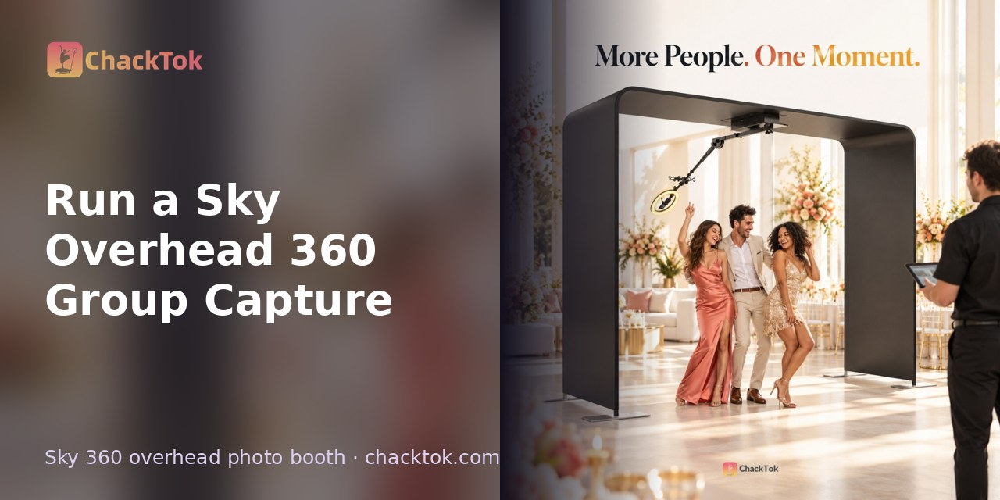
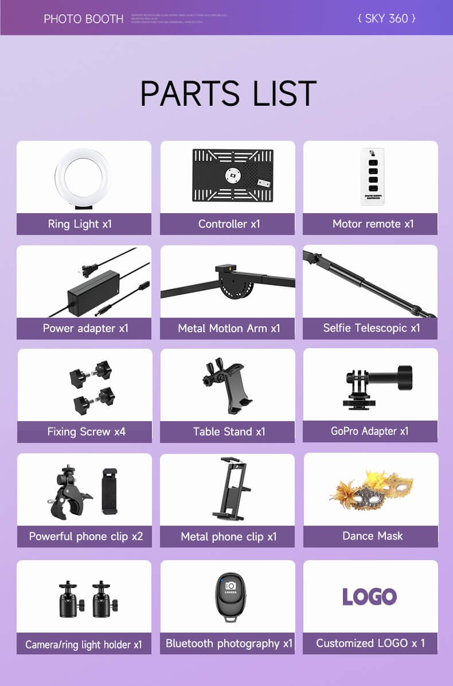
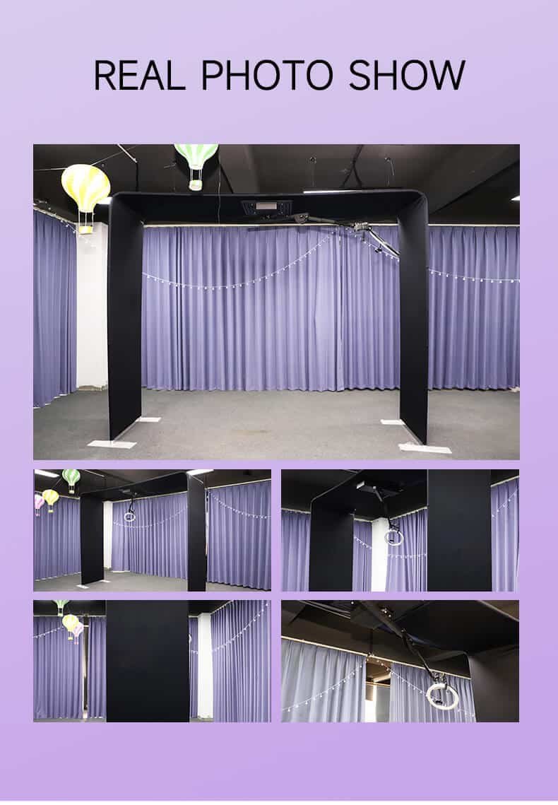
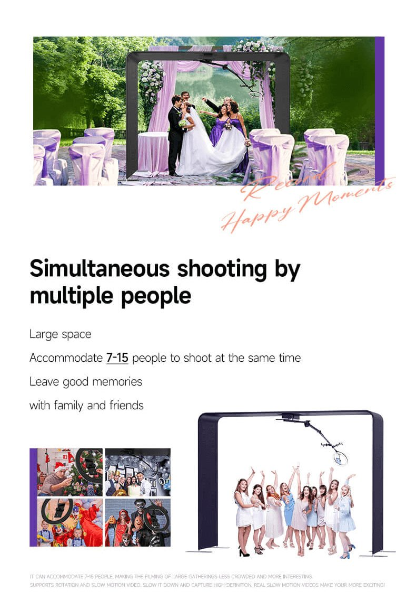
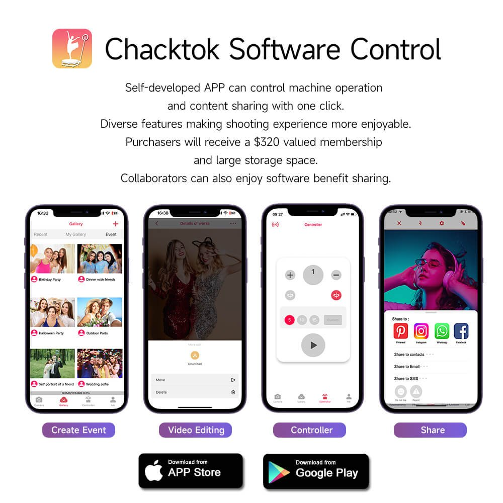

# Run a Sky Overhead 360 Group Capture

A Sky overhead 360 booth captures guests standing in a defined floor area while a camera assembly moves around them from an overhead structure. Use this guide to prepare the venue, configure a supported ChackTok workflow, and rehearse the journey from group positioning to media delivery. Keep the exact hardware instructions available throughout assembly and operation.

## When to Use This Guide

- Preparing a wedding party, company team, or other group capture.
- Adding an overhead format to an existing ChackTok event workflow.
- Handing a configured booth to the attendant who will run the booking.

## What to Prepare

- Exact frame, arm, light, capture-device holder, and supplied controls.
- Manufacturer's assembly instructions and operating limits.
- Suitable venue position, power, loading access, and full movement clearance.
- Capture device and software configuration selected for the event.
- Approved event name, creative assets, and media format.
- Assigned attendant, guest route, and tested sharing plan.

The configuration described in the source guide has a listed size of 120 × 84 inches and an intended group range of approximately 7–15 people. Establish the event layout using the exact package's assembled dimensions and full movement clearance; select the group arrangement through a representative capture test.

Official Sky 360 parts list — check it against the package you deliver.

## Setup Steps

1. Confirm the venue position, floor, ceiling space, nearby fixtures, power, loading route, and waiting-line position against the hardware requirements.
2. Assemble the frame according to the package instructions. Inspect connections and mounts before fitting the capture device.
3. Establish the arm's movement boundary. Keep the guest route, queue, bags, cables, and loose props clear of that area.
4. Secure the capture device and light. Test framing and faces at the center and outer edges of the intended standing area.
5. Connect the controls supported by the equipment. Test direction, speed, operating time, and the stopping procedure with the movement area clear.
6. Load the event design and selected content format. Check the event identity, frame, logo, and music in a finished test item.
7. Rehearse with a representative group. Adjust positions, group size, and the guest prompt to suit the reviewed result.
8. Save and reopen the media. Test every sharing route the attendant will offer from the recipient's side.
9. Brief the attendant on standing positions, the chosen group size, guest entry and exit, the stopping procedure, and delivery follow-up.

Real installation photos of the Sky 360.

## Group Capture Check

Give guests one short instruction that matches the rehearsed movement. Check tall participants, people near the edges, and props before starting the sequence. Keep an attendant with the booth during operation.

Use the actual event camera and lens when selecting the group arrangement. Review a complete clip on a phone so the team can inspect the result guests will receive.

For a larger party, organize additional compositions when that produces a better frame and a more manageable guest flow.

The official Sky 360 configuration is described for approximately 7–15 people.

## ChackTok Configuration Check

Supported hardware and capture configurations can use ChackTok controls such as direction, speed, and operating time. Confirm the controls available on the selected package and test any supplied button or remote used by the team.

Content options described in the source include photo, normal video, slow-motion video, Boomerang, and GIF formats according to the capture setup and software configuration. Choose the format needed for the booking and review the event assets in its finished output.

Sharing workflows can include QR code, SMS, or email. Record the routes tested for the venue and assign responsibility for checking tasks interrupted by unavailable connectivity.

ChackTok app: booth control, templates and sharing in one workflow.

## Before Guests Arrive

- [ ] Assembly, mounts, movement clearance, and stopping procedure checked.
- [ ] Standing area, guest route, attendant position, and queue established.
- [ ] Representative group filmed with the actual device and lens.
- [ ] Lighting and framing reviewed across the group.
- [ ] Event design reviewed in a finished item.
- [ ] Media saved and reopened.
- [ ] Each offered delivery route checked from the recipient's side.
- [ ] Attendant briefed and delivery follow-up assigned.

## Troubleshooting

| Observation | Next check |
| --- | --- |
| Guests at the edge are cropped | Review lens, standing positions, gestures, and group size using a test clip. |
| Faces have uneven lighting | Adjust the selected light settings and review center and edge positions. |
| Controls behave unexpectedly | Stop operation, keep the movement area clear, and verify the exact hardware/control configuration. |
| Finished design differs from the brief | Confirm the selected event, content format, and creative assets, then make a new test item. |
| Recipient cannot access the item | Locate the saved media, inspect the selected sharing route and task state, and have the assigned person follow up. |

Resume after an equipment concern only when its cause has been checked. For outdoor operation, confirm the exact unit's limits and the venue's weather, ground, and power arrangements.

## FAQ

### Where do guests stand?

On the floor within the defined capture area beneath the overhead structure.

### How should the team choose group size?

Use a representative capture with the actual device, lens, standing positions, and planned gestures, then review the finished result.

## Related Guides

- [Connect a 360 Photo Booth](connect-360-booth.md)
- [Create and manage events](event-setup.md)
- [Media creation and editing](media-creation-editing.md)
- [Troubleshooting](troubleshooting.md)

## Official Source

- [Sky 360 Photo Booth: A Guide to Big Group Events](https://www.chacktok.com/sky-overhead-360-photo-booth-guide/)
